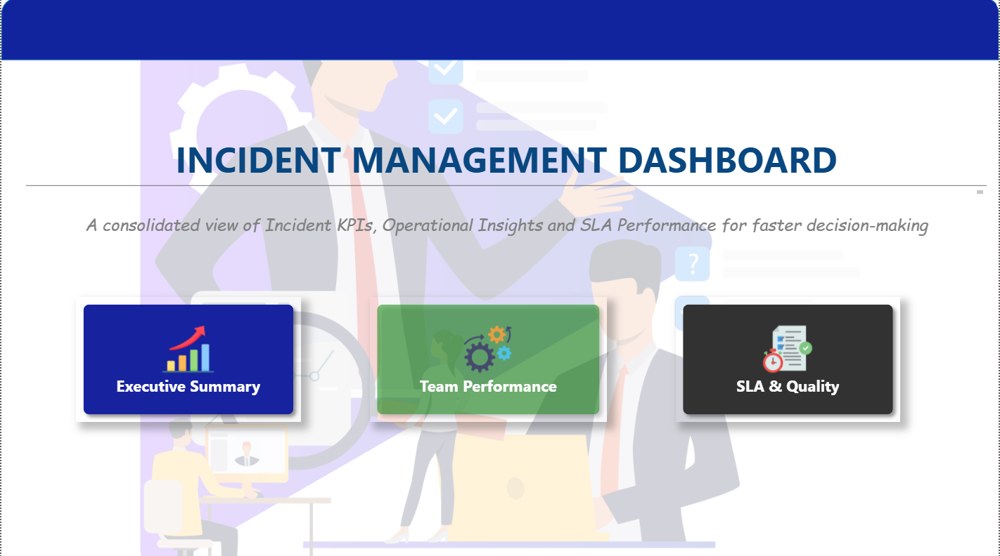

# 🛠️ ITSM Incident Management Dashboard (Power BI & Excel)
### **Enterprise IT Service Management • SLA & Quality Tracking • Team Performance Analytics**

<p align="left">
  
  
  
</p>

---

## 📌 Project Overview
This project delivers an enterprise-grade **ITSM Incident Management Dashboard** built using Power BI and Excel to monitor, analyze, and optimize IT support operations. It aggregates incident logs to provide leadership and support teams with deep visibility into ticket volumes, geographic distribution, SLA compliance rates, agent productivity, and resolution bottlenecks.

---

## 🏠 Dashboard Landing Page & Navigation Suite
The reporting suite features a centralized home page with intuitive card navigation, allowing stakeholders to seamlessly transition between specific analytical views.

<p align="center">
  
</p>

---

## 📊 Detailed Section Breakdown & Visual Architecture

### 1️⃣ Executive Summary View
Provides high-level leadership with an instant overview of total ticket volume, current status distribution, and monthly trends.

<p align="center">
  
</p>

* **Core KPI Cards:** Total Tickets (500), Open Tickets (151), Closed Tickets (349), Reopened % (11.0%), and P1 Critical Tickets (47).
* **Breakdown Visuals:** 
  * **Tickets by Region:** Even distribution across India (130), APAC (126), Europe (123), and US (121).
  * **Tickets by Priority:** Percentage breakdown across P1, P2, P3, and P4 priorities.
  * **Tickets by Status:** Breakdown of Closed, Open, Resolved, and Pending operational states.
  * **Monthly Ticket Trend:** Line chart tracking ticket creation flow across the calendar year.

---

### 2️⃣ SLA & Quality Analysis View
Focuses on service level agreement (SLA) compliance, resolution time bottlenecks, and quality assurance metrics.

<p align="center">
  
</p>

* **Core Metrics & Visuals:**
  * **SLA Met vs. Breached:** Doughnut chart displaying overall compliance vs. breaches (78.22% Met vs. 21.78% Breached).
  * **Incident Category Trend:** Multi-line trend analysis tracking Access, Application, Database, Hardware, and Network tickets over time.
  * **Resolution Time by Priority:** Bar charts evaluating average resolution speed per priority tier.
  * **Aging Bucket Distribution:** Funnel analysis grouping tickets by resolution timeframes (0-24 hrs, 24-48 hrs, 48-72 hrs, 72+ hrs).
  * **Reopened Tickets by Category:** Horizontal ranking showing which categories experience the highest recurrence rates.

---

### 3️⃣ Team & Agent Performance View
Evaluates group efficiency, individual agent workloads, and resolution speeds to optimize resource allocation.

<p align="center">
  
</p>

* **Core Metrics & Visuals:**
  * **Team Summary Cards:** SLA Met % (21.8%), SLA Breached % (78.2%), Average Resolution Time (36.22 Hrs), Total Groups (5), and Total Agents (6).
  * **Tickets by Group & SLA Breaches:** Comparing ticket volume and breach ratios across App Team, DB Team, L1/L2 Support, and Infra Team.
  * **Tickets by Agent & Resolution Time:** Individual workload tracking and comparative performance metrics across Agent A through Agent F.

---

## 💡 Key Technical Competencies & Skills

| Domain | Core Tools & Proficiencies | Practical Application in Project |
| :--- | :--- | :--- |
| **Business Intelligence** | Power BI Desktop, Interactive Navigation, Custom UI | Designing multi-page report suites with dedicated landing menus and drill-through features. |
| **Data Analytics & DAX** | Calculated Measures, Time Intelligence, Aggregations | Authoring custom DAX formulas to calculate SLA breach percentages, reopened ticket rates, and resolution averages. |
| **Data Preparation & ETL** | Power Query, Data Cleansing, Normalization | Ingesting raw IT service logs (`itsm_incident_dataset.csv`), handling null closure dates, and structuring data models. |
| **Spreadsheet Modeling** | Excel (Advanced Formulas, Pivot Tables) | Pre-processing operational datasets and validating metrics prior to BI visualization. |
| **ITSM Domain Knowledge** | ITIL Incident Lifecycle, SLA Tracking, Ticket Aging | Translating IT support metrics into actionable insights for operational efficiency and root-cause analysis. |

---

## ⚙️ Project Workflow & Methodology
1. **Data Ingestion & Staging:** Imported raw incident records containing timestamps, priorities, categories, and agent details.
2. **Data Transformation (Power Query):** Cleaned null values in closure timestamps, normalized category names, and structured relational fields.
3. **DAX Measure Formulation:** Developed core calculated metrics including SLA compliance ratios, ticket aging buckets, and agent resolution speeds.
4. **Interactive Dashboard Design:** Built a 4-page UI featuring consistent color palettes, dynamic slicers (Date range, Region, Priority, Assigned Group), and card-based navigation.

---

## 📁 Repository Structure
```text
├── itsm_incident_dataset.csv       # Raw IT service incident dataset
├── Incident_Analaysis.pbix           # Power BI interactive report suite
├── Dashboard.png                     # Landing page UI preview
├── Executive Summary.png             # Executive summary dashboard view
├── SLA & Quality Analysis.jpg        # SLA and quality metrics view
├── Team Performance.jpg              # Team and agent performance view
└── README.md                         # Project Documentation